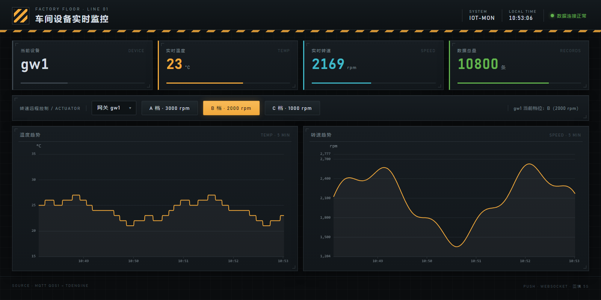

# EdgePulse · 工业物联网全链路示例

Node.js 实现的工业物联网示例集，覆盖 **MQTT 发布/订阅、指令下发、Modbus 设备采集** 三条核心链路，演示生产级做法：**QoS 1 保证送达 + 业务层幂等去重**。

**生产级 IoT 的本质 = 假设一切都会坏（网络断、机器挂、消息丢、数据乱），然后让系统在坏的情况下仍然不丢数据、不产生错误业务结论。**



*大屏预览：温度/转速为最近 5 分钟曲线，读数卡片实时刷新（截图为演示数据）*

## 文件总览

| 文件 | 角色 | 对应工业链路 |
|---|---|---|
| `src/mqtt/publisher.js` | MQTT 发布端（传感器上报） | 设备/网关 → 平台（上行） |
| `src/mqtt/subscriber.js` | MQTT 订阅端（平台接收 + 幂等去重 + 告警） | 平台接收端 |
| `src/device/device.js` | 设备端（收指令 + 执行 + ack 应答） | 网关收下行指令 |
| `src/device/control.js` | 平台控制端（发指令 + 等应答 + 超时） | 平台下发指令 |
| `src/device/modbus-sim.js` | 模拟 Modbus TCP 从站设备（`[端口] [从站号] [设备名]`，可起多台） | 真实设备 |
| `src/device/modbus-reader.js` | Modbus 主站（轮询读寄存器 + 写寄存器） | 网关/采集器 |
| `src/gateway/gateway.js` | **完整网关**（`[网关ID] [设备端口] [从站地址]`）：Modbus 读设备 → SQLite 缓存 → MQTT 上报 + 收指令写回（断线补报 + 转速三档） | 设备 → 网关 → 平台全链路 |
| `src/gateway/start-farm.js` | 一键启动 3 台设备 + 3 个网关（多终端多网关集群） | 多网关演示 |
| `src/tsdb/tsdb-sink.js` | **时序库入库器**：订阅 MQTT 数据 → 写 TDengine（REST），写不进自动暂存重试 | 平台 → 时序库 |
| `src/tsdb/tsdb-query.js` | 从 TDengine 查最近数据 + 各设备统计 | 数据验证 |
| `src/dashboard/dashboard-server.js` | **实时监控大屏后端**：查 TDengine → API + WebSocket `/ws` 实时推送 → 托管页面 | 数据可视化 |
| `public/index.html` | 大屏前端：实时数值卡片 + 温度/转速曲线（WebSocket 实时推送，HTTP 5 秒回填） | 数据可视化 |
| `docs/*.md` | 生产级 IoT 开发教程（第 0-6 章 + 附录 A，按章节拆分） | 文档 |
| `data/*.db` | 网关缓存与入库暂存（SQLite，运行期生成） | 本地持久化 |

## 教程目录：生产级 IoT 开发教程

教程已按章节拆分到 `docs/`，可单独阅读：

| 章节 | 主题 | 文件 |
|---|---|---|
| 第 0 章 | 定位：本仓库代码是什么级别，生产还差什么 | [00-positioning.md](docs/00-positioning.md) |
| 第 1 章 | 生产级系统架构 | [01-architecture.md](docs/01-architecture.md) |
| 第 2 章 | 生产级要求（七大项） | [02-requirements.md](docs/02-requirements.md) |
| 第 3 章 | 难点清单与应对策略（核心章节，12 个难点） | [03-challenges.md](docs/03-challenges.md) |
| 第 4 章 | 从本仓库到生产：改造路线图 | [04-roadmap.md](docs/04-roadmap.md) |
| 第 5 章 | 生产部署拓扑（演进路线） | [05-topology.md](docs/05-topology.md) |
| 第 6 章 | 研究学习要点（如何检验是否真正掌握） | [06-learning.md](docs/06-learning.md) |
| 附录 A | 生产 checklist（交付前逐项打勾） | [appendix-a-checklist.md](docs/appendix-a-checklist.md) |

## 前置条件

- 本机已安装并启动 Mosquitto（MQTT broker，默认端口 1883）
- Node.js（本项目在 v24 下验证）
- Broker 地址可通过环境变量 `MQTT_URL` 覆盖（默认 `mqtt://localhost:1883`），换 EMQX 等 broker 无需改代码；TDengine 地址同理用 `TD_URL`

## 使用步骤

```bash
npm install
```

### 场景 1：MQTT 温度上报（设备 → 平台）

```bash
node src/mqtt/subscriber.js   # 终端 1：平台订阅
node src/mqtt/publisher.js    # 终端 2：传感器每秒上报
```

### 场景 2：指令下发（平台 → 设备）

```bash
node src/device/device.js       # 终端 1：设备端（上报 + 收指令 + 应答）
node src/device/control.js      # 终端 2：平台发 3 条指令（8 秒后自动退出）
```

### 场景 3：Modbus 设备采集

```bash
node src/device/modbus-sim.js   # 终端 1：模拟 Modbus 设备（监听 127.0.0.1:5020）
node src/device/modbus-reader.js # 终端 2：轮询读温度/转速 + 演示写寄存器
```

### 场景 4：全链路（设备 → 网关 → 平台）

```bash
node src/device/modbus-sim.js   # 终端 1：模拟 Modbus 设备
node src/gateway/gateway.js      # 终端 2：网关（读设备 → MQTT 上报 + 收指令写回）
node src/mqtt/subscriber.js   # 终端 3：平台订阅端（收上报数据）
node src/device/control.js      # 终端 4：平台控制端（发指令，8 秒后自动退出）
```

网关上报数据含 `deviceId: 'gateway-001'`（区别于直接上报的 `sensor-001`），在 subscriber 输出中可区分。

### 场景 5：断线缓存补报演示

```bash
node src/device/modbus-sim.js   # 终端 1：模拟 Modbus 设备
node src/mqtt/subscriber.js   # 终端 2：平台订阅端
SIMULATE_OFFLINE_MS=10000 node src/gateway/gateway.js  # 终端 3：启动 1 秒后模拟断网，10 秒后恢复
```

网关输出可见：断网期间 `⏸ MQTT 离线，缓存 N 条待补报`，恢复后 `📤 补报 N 条缓存数据`；
平台端在恢复瞬间一次性收到断网期间积压的数据（可从 `ts` 字段看出是断网时段产生的）。
缓存文件为 `data/gateway-cache-<网关ID>.db`（SQLite），补报成功后自动清空。

### 场景 6：数据入库 TDengine（时序库）

前置：安装 TDengine（<https://www.taosdata.com/getting-started>），验证 `show databases;` 可连。

```bash
node src/device/modbus-sim.js   # 终端 1：模拟 Modbus 设备
node src/gateway/gateway.js      # 终端 2：网关
node src/tsdb/tsdb-sink.js    # 终端 3：订阅 MQTT → 写入 TDengine（自动建库建表）
node src/tsdb/tsdb-query.js   # 终端 4：查询验证最近数据
```

- 入库器默认连 `http://localhost:6041`（REST），账号 `root/taosdata`，库 `iot_demo`，超级表 `device_data`
- **可靠性**：TDengine 不可用时数据暂存 `data/tsdb-pending.db`，每 5 秒重试，恢复后自动补写
- 换环境可用环境变量：`TD_URL` 指定 REST 地址

### 场景 7：网页实时监控大屏

前置：TDengine 已启动，且 1-4 号进程在跑（设备 → 网关 → 入库器）。

```bash
node src/dashboard/dashboard-server.js   # 启动大屏服务
# 浏览器打开 http://localhost:3000
```

大屏展示：实时温度/转速卡片（温度 > 27°C 变红）、最近 5 分钟温度/转速曲线（ECharts）、数据总量统计。

- **实时推送走 WebSocket**：大屏服务订阅 MQTT 数据主题 `factory/+/temperature`，收到即通过 `ws://localhost:3000/ws` 推到页面，卡片和曲线即时更新（无 2 秒轮询延迟）
- **HTTP 只做回填**：每 5 秒拉一次历史/统计补全曲线，断线自动重连（3 秒后重试）
- 推送消息格式：`{"type":"data","data":{"deviceId":"gw1","temperature":25,"speed":2000,"ts":169...}}`

API 接口：

- `GET /api/latest?gateway=gw1` — 最新一条设备数据（可按网关过滤）
- `GET /api/history?minutes=5&gateway=gw1` — 最近 N 分钟历史（可按网关过滤）
- `GET /api/stats?gateway=gw1` — 各设备数据量（可按网关过滤，不传返回全部）
- `GET /api/speed` — 查询当前档位 + 最近指令 ack
- `POST /api/speed` `{"gateway":"gw1","level":"A"}` — 远程设定指定网关设备转速：A=3000、B=2000、C=1000 rpm（经 MQTT 指令下发网关 → Modbus 写设备转速寄存器）
- `WS /ws` — 设备数据实时推送（页面自动连接）

依赖 `echarts`、`ws`（本地资源，无需 CDN）。调速指令链路：页面按钮 → `/api/speed` → MQTT `set_speed` → 网关写寄存器 → 设备转速改变 → 数据经 WebSocket 实时回流大屏（网关需运行 `gateway.js`，大屏服务订阅 `cmd/ack` 确认）。

### 场景 8：多终端多网关集群

```bash
node src/gateway/start-farm.js     # 终端 1：一键启动 3 台设备（5020/5021/5022）+ 3 个网关（gw1/gw2/gw3）
node src/tsdb/tsdb-sink.js      # 终端 2：入库器（通配符订阅 factory/+/temperature，收所有网关）
node src/dashboard/dashboard-server.js # 终端 3：大屏服务
```

- 主题隔离：数据 `factory/{gwId}/temperature`、指令 `factory/{gwId}/cmd`、应答 `factory/{gwId}/cmd/ack`——各网关互不干扰
- 大屏：网关下拉选择 gw1/gw2/gw3 后点档位按钮，**只对选中网关调速**；曲线按网关分色显示
- 手动启动单个网关示例：`node src/gateway/gateway.js gw2 5021 2`（连 5021 端口设备、从站地址 2，**从站地址必须与设备一致**）

## 关键知识点

| 要点 | 说明 |
|---|---|
| `{ qos: 1 }` | 至少一次：保证消息到达，但可能重复 |
| `clean: false` | 会话保持：断线重连后继续接收未消费的消息 |
| 业务幂等 | 按 `deviceId + ts` 去重，60 秒窗口内重复消息直接忽略 |
| 指令 ack | 指令带 `msgId`，设备应答回传同一 `msgId`，平台据此匹配 |
| Modbus | 主站问、从站答；数据放编号寄存器（保持/输入寄存器）；RTU 走串口、TCP 走网线 |
| ServerTCP 签名 | `new ModbusRTU.ServerTCP(vector, options)` —— vector 在前 |
| WebSocket 推送 | 大屏服务订阅 MQTT 数据后经 `/ws` 直推前端；前端断线 3 秒重连，HTTP 轮询只做历史回填 |

## 已实现能力

- **时序库存历史**：TDengine 入库（`tsdb-sink.js` 自动建库建表、断库暂存补写），`tsdb-query.js` 查询验证；MySQL / InfluxDB 未接入
- **实时推送**：WebSocket `/ws`（MQTT 数据 → 大屏即时更新，断线自动重连）
- **网关模式**：Modbus 读设备 → MQTT 上报 → 指令写回（`gateway.js` 把 modbus-reader 与 publisher 两条链路合为一体）
- **断线缓存补报**：网关数据先落本地 SQLite，MQTT 恢复后自动补报（平台端幂等兜底重复）
- **Broker 可替换**：全部脚本支持 `MQTT_URL` 环境变量，可直连 EMQX 等任意 broker

## 后续可扩展

- MySQL / InfluxDB 接入（把入库器的写入目标换成对应驱动）
- 大屏鉴权 + 网关在线心跳（离线网关置灰）
- EMQX 集群 / TLS 接入（连接串加 `mqtts://` 并配置证书）

## 许可证

[MIT](LICENSE)
